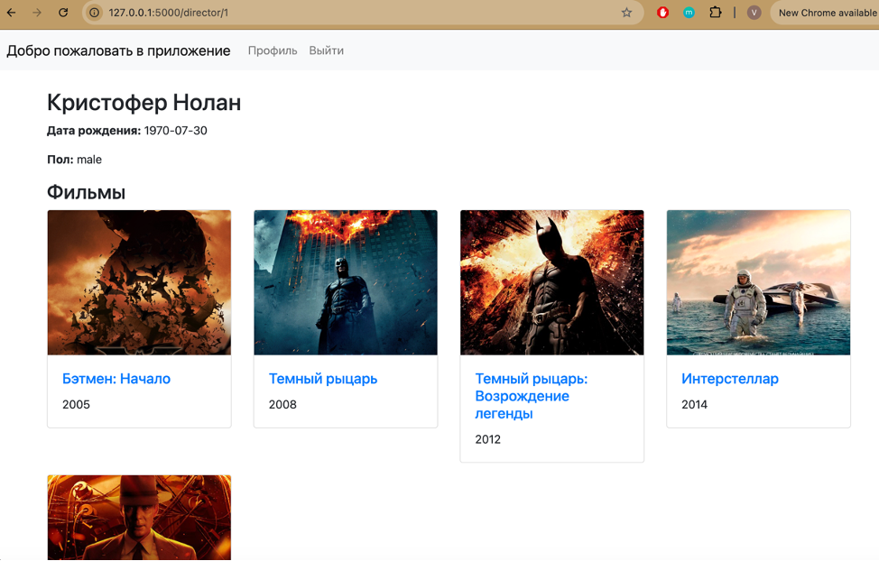
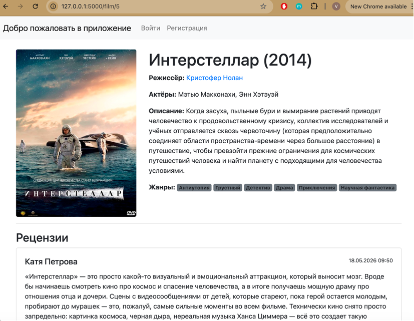
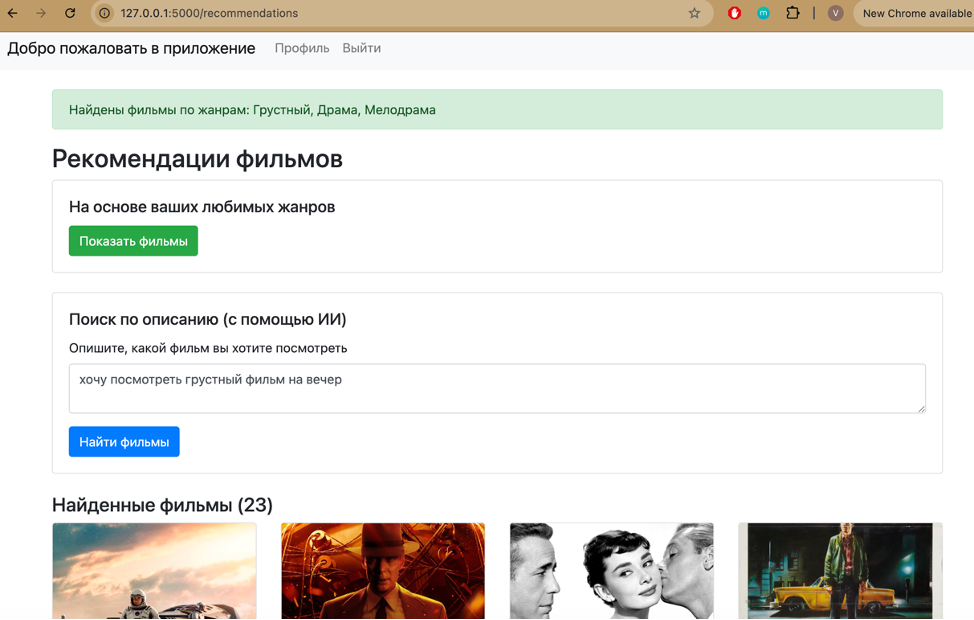
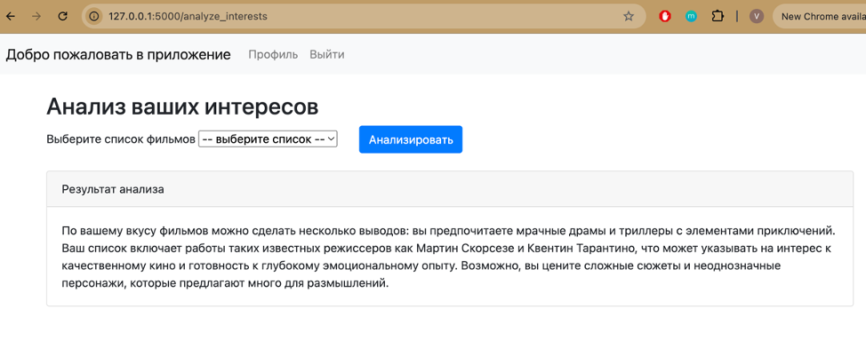
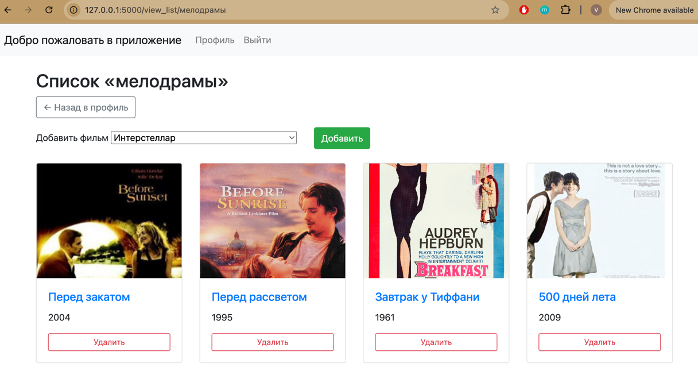

# CineJournal

Веб-приложение для каталогизации фильмов с персональными списками, рецензиями и рекомендациями на основе локальной языковой модели.

Пользователи могут собирать коллекции фильмов, отмечать любимые жанры, обсуждать просмотренное и получать рекомендации на основе своих предпочтений. Для анализа интересов и подбора фильмов по текстовому описанию используется Qwen2.5:7b, работающая локально через Ollama.

Архитектура приложения не привязана исключительно к фильмам: при замене каталога и справочника жанров её можно адаптировать для работы с книгами, музыкой, играми и другим контентом.

## Скриншоты

### Каталог фильмов режиссера



### Страница фильма



### Рекомендации



### Анализ интересов пользователя



### Список фильмов



## Возможности

### Каталог

- Поиск фильмов по названию и режиссёру без учёта регистра.
- Страницы фильмов с постерами, описаниями, жанрами, рецензиями и комментариями.
- Страницы режиссёров со списком их фильмов.

### Пользовательские функции

- Создание и удаление списков фильмов.
- Добавление и удаление фильмов в списках.
- Управление любимыми жанрами.
- Публикация рецензий и комментариев.
- Удаление собственных рецензий.
- Просмотр своих рецензий в профиле.

### Нейросетевые функции

- **Анализ интересов** — формирование текстового описания предпочтений на основе выбранного списка фильмов.
- **Рекомендации по жанрам** — поиск фильмов, соответствующих любимым жанрам пользователя.
- **Рекомендации по описанию** — подбор жанров на основе произвольного текстового запроса с последующим поиском подходящих фильмов в базе данных.

Языковая модель работает локально через Ollama. Внешние AI API не используются.

### Управление каталогом

- Добавление и редактирование фильмов и режиссёров.
- Выбор нескольких жанров для фильма.
- Загрузка постеров в форматах JPG и PNG.
- Удаление фильмов с очисткой постеров и связанных записей.

### Роли пользователей

| Роль | Доступные возможности |
| --- | --- |
| Гость | Поиск и просмотр каталога |
| `user` | Списки, жанры, рецензии, комментарии и рекомендации |
| `moderator` | Управление фильмами и режиссёрами |

## Технологии

| Компонент | Технология |
| --- | --- |
| Язык | Python 3.10+ |
| Веб-фреймворк | Flask |
| База данных | PostgreSQL 14+ |
| Доступ к БД | psycopg 3, SQL |
| Шаблонизатор | Jinja2 |
| Интерфейс | Bootstrap 5 |
| Формы и валидация | Flask-WTF, WTForms |
| Авторизация | Flask-Login, Werkzeug |
| Языковая модель | Qwen2.5:7b |
| Локальный запуск модели | Ollama |
| HTTP-клиент | requests |
| Переменные окружения | python-dotenv |

## Установка и запуск

### Требования

- Python 3.10 или новее
- PostgreSQL 14 или новее
- Ollama для работы нейросетевых функций

### 1. Установка зависимостей

Рекомендуется использовать виртуальное окружение.

**Windows**

```powershell
python -m venv venv
venv\Scripts\activate
```

**Linux / macOS**

```bash
python3 -m venv venv
source venv/bin/activate
```

Установите зависимости проекта:

```bash
pip install -r requirements.txt
```

Если файл `requirements.txt` отсутствует:

```bash
pip install flask flask-login flask-wtf psycopg python-dotenv werkzeug requests
```

### 2. Настройка базы данных

Создайте базу данных PostgreSQL:

```bash
createdb movieapp
```

Примените SQL-схему:

```bash
psql -U your_user -d movieapp -f app/db/schema.sql
```

Замените `your_user` на имя пользователя PostgreSQL. Скрипт `app/db/schema.sql` создаёт необходимые таблицы и заполняет справочник жанров.

### 3. Настройка окружения

Создайте файл `.env` в корне проекта:

```dotenv
SECRET_KEY=change-me-to-a-random-string

POSTGRES_USER=your_user
POSTGRES_PASSWORD=your_password
POSTGRES_HOST=localhost
POSTGRES_PORT=5432
POSTGRES_DB=movieapp
```

Укажите параметры подключения к своей базе данных. Для `SECRET_KEY` используйте случайную строку.

Переменные окружения загружаются с помощью `python-dotenv`.

### 4. Настройка Ollama

Установите Ollama с официального сайта: [ollama.com](https://ollama.com/).

Загрузите используемую модель:

```bash
ollama pull qwen2.5:7b
```

Запустите сервер Ollama:

```bash
ollama serve
```

По умолчанию API Ollama доступен по адресу `http://localhost:11434`. Приложение использует endpoint `/api/chat`.

Для работы рекомендаций и анализа интересов Ollama должна быть запущена, а модель `qwen2.5:7b` — загружена.

### 5. Запуск приложения

Из корневой директории проекта выполните:

```bash
python run.py
```


## Первый запуск

1. Зарегистрируйте аккаунт.
2. Для наполнения каталога используйте роль модератора и его панель.
3. Для работы с пользовательскими списками, рецензиями и рекомендациями используйте роль пользователя.

Доступные функции зависят от назначенной пользователю роли.

---

## English

**CineJournal is a web application for managing movie collections, writing reviews, and discovering films through AI-powered recommendations. Built with Flask and PostgreSQL, it uses a locally hosted Qwen2.5:7b model via Ollama to analyse user preferences and match free-text descriptions to movie genres. Its architecture can be adapted to other types of content.
